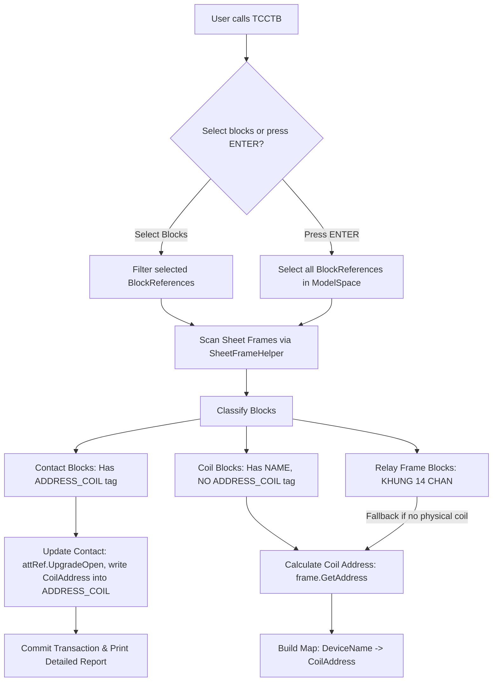
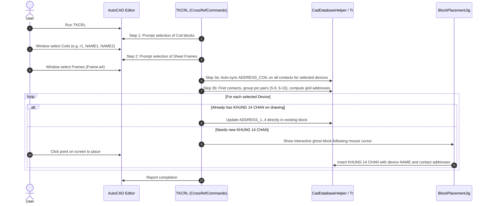

# AGENTS.md - Developer & Agent Guide for CadElectricalToolkit

> **Target Audience:** AI Coding Agents (Antigravity, Claude, Copilot, etc.) and Human Engineers working on this codebase.  
> **Repository Root:** `f:/1.Project/1.C_shard/C_AutoCad/`  
> **Primary Technology:** C# .NET Framework 4.8, AutoCAD .NET Managed API (2021+), WinForms.

---

## 1. Project Overview & Mission

**CadElectricalToolkit** is a high-performance AutoCAD add-in plugin that brings AutoCAD Electrical-style automation into standard vanilla AutoCAD (2021, 2022, 2023, 2024, 2025+).

Industrial electrical designers often use standard AutoCAD for panel drafting and mechanical layouts because AutoCAD Electrical is heavy and rigid. This plugin enables them to work in standard AutoCAD while automating:
1. **Cross-referencing (Tham chiếu chéo rơ-le / contactor):**
   - Automatically link contact blocks (`NO auxiliary contact`, `NC auxiliary contact`) with coil blocks (`COIL_CONTACTOR`, `RL_COIL`).
   - Calculate exact grid coordinates (`SheetNo-RowCol`, e.g., `01-4A`, `02-5B`).
   - Populate cross-reference tables (block `KHUNG 14 CHAN` for Omron MY4N, IDEC RU4S, Schneider relays).
   - Write coil addresses to contact attributes (`ADDRESS_COIL`) in bulk.
2. **Title Block & Sheet Management (Quản lý khung tên & số trang):**
   - Auto-number sheets with prefix/suffix/formatting, e.g. `Page/Total` (`12/24`) via interactive UI (`DSTTKBT`).
   - Sheet indexing table (`TKDMBV`).
3. **Wire Numbering & Ferrule Tags (Đánh số dây & gen số):**
   - Sequential wire tagging (`INSGEN`), ferrule list export (`TKGEN`), sheet-based sync (`SYNGEN`).
4. **Terminal Strips (Cầu đấu dây):**
   - Terminal report (`TKCD`) and terminal re-numbering (`SYNCD`).
5. **PLC I/O Addressing:**
   - Digital Input/Output address assignment (`TKPLCIN`, `TKPLCOUT`, `SYNPLC`).
6. **BOM & Data Export:**
   - Bill of Materials (`TKDMTB`) and CAD-to-Excel export (`CAD2EXCEL`).
7. **Drafting Acceleration:**
   - Quick dimension summation (`CDN`), fast sequential text numbering (`DSTT`), text alignment (`GTD`, `GTN`).
8. **Link Tracing & Navigation (Truy vết liên kết trang):**
   - Click on Arrow-To/From block or Relay contact/coil to find destination page and draw visual guide line directly to the target `Frame-a4` title block (`TIMTRANG`, `TRACE`, `XOALINK`).

---

## 2. Architecture & Directory Layout

```text
C_AutoCad/
├── AGENTS.md                                # This agent onboarding & architecture reference
├── README.md                                # General project documentation
├── CadElectricalToolkit.slnx                 # Solution file
├── bin/Release/CadElectricalToolkit.dll      # Standalone release output
├── bundle/
│   └── CadElectricalToolkit.bundle/         # Autodesk Autoloader structure
│       ├── PackageContents.xml              # Autoloader manifest
│       └── Contents/net48/                  # Target output for AutoCAD auto-load
│           └── CadElectricalToolkit.dll
├── docs/                                    # Extended documentation
│   ├── ARCHITECTURE_AND_WORKFLOW.md
│   └── .docs/
│       ├── PROJECT_ANALYSIS_AND_ROADMAP.md
│       ├── README.md
│       └── TEST_GUIDE_AND_BLOCK_SPEC.md
└── src/
    └── CadElectricalToolkit/
        ├── CadElectricalToolkit.csproj      # .NET Framework 4.8 target
        ├── AppEntryPoint.cs                 # IExtensionApplication (Initialize / Terminate)
        ├── Core/
        │   └── ElectricalConfig.cs          # Centralized configuration (Tags, Grid, Margins)
        ├── CadAccess/                       # AutoCAD API wrappers & database access
        │   ├── CadDatabaseHelper.cs         # Document locking & Transaction runner
        │   ├── AttributeHelper.cs           # Safe Block & Attribute reading/writing
        │   ├── SelectionHelper.cs           # Entity scanning & selection filters
        │   ├── SheetFrameHelper.cs          # Sheet title frame bounding box & grid resolution
        │   ├── BlockPlacementJig.cs         # Interactive mouse Jig for placing blocks one by one
        │   ├── BlockDefinitionHelper.cs     # Sample blocks creation (TAOBLOCKMAU)
        │   └── TableHelper.cs               # AutoCAD Native Table generator
        ├── Commands/                        # AutoCAD [CommandMethod] Entry Points
        │   ├── CrossRefCommands.cs          # TCCTB, TKCRL, SYNCRL, KTCRL, DSTTKBT
        │   ├── TraceCommands.cs             # TIMTRANG, TRACELINK, TRACE, XOALINK (Vẽ line chỉ dẫn truy vết trang)
        │   ├── WireNumberCommands.cs        # INSGEN, TKGEN, SYNGEN
        │   ├── TerminalCommands.cs          # TKCD, SYNCD
        │   ├── PlcCommands.cs               # TKPLCIN, TKPLCOUT, SYNPLC
        │   ├── SheetCommands.cs             # TKDMBV, SYNREV, SYNTF, GBV, TBV
        │   ├── BomCommands.cs               # TKDMTB, CAD2EXCEL
        │   ├── DraftingCommands.cs          # CDN, DSTT, DOIATT, DATTR, GTD, GTN
        │   └── AboutCommands.cs             # ELECINFO, TT, TAOBLOCKMAU, SAMPLEBLOCKS
        └── UI/
            ├── CadWindowHelper.cs           # WPF Window modal dialog & AutoCAD handle integration
            ├── Mvvm/                        # Core MVVM infrastructure
            │   ├── ViewModelBase.cs         # INotifyPropertyChanged base implementation
            │   └── RelayCommand.cs          # ICommand implementation for WPF bindings
            ├── Services/                    # Decoupled CAD interaction services
            │   ├── ICadInteractionService.cs# CAD picking, selecting, batch editing contract
            │   └── CadInteractionService.cs  # Implementation using AutoCAD Editor & Database
            ├── ViewModels/                  # MVVM ViewModels
            │   ├── AutoNumberingViewModel.cs# ViewModel for Frame, Block Attr, & Batch Replace tabs
            │   └── ToolInfoViewModel.cs     # ViewModel for command search & cheatsheet window
            └── Views/                       # Modern Dark WPF Windows (pure XAML & thin code-behind)
                ├── ToolInfoWindow.xaml      # Commands cheatsheet & quick run UI (WPF)
                ├── ToolInfoWindow.xaml.cs   # Thin code-behind wiring ToolInfoViewModel
                ├── AutoNumberingWindow.xaml # Auto numbering dialog for Frames & Block attributes (WPF)
                └── AutoNumberingWindow.xaml.cs # Thin code-behind wiring AutoNumberingViewModel
    └── CadElectricalToolkit.UiRunner/       # Standalone UI runner for testing outside AutoCAD
        ├── CadElectricalToolkit.UiRunner.csproj
        ├── App.xaml / App.xaml.cs
        └── MainWindow.xaml / MainWindow.xaml.cs
```

---

## 3. Critical AutoCAD .NET Gotchas & Coding Rules

When modifying or adding C# code in this codebase, **YOU MUST ADHERE TO THESE RULES**:

### Rule 1: NEVER call `tr.GetObject(id, OpenMode.ForWrite)` if `id` was already opened `ForRead`
- **Gotcha:** If an entity or attribute was opened with `OpenMode.ForRead` earlier in the same transaction, calling `tr.GetObject(id, OpenMode.ForWrite)` throws `Autodesk.AutoCAD.Runtime.Exception: eWasOpenForRead`. This aborts the transaction immediately.
- **Pattern:** Always open with `OpenMode.ForRead`. When modification is needed, check:
  ```csharp
  if (!entity.IsWriteEnabled)
  {
      entity.UpgradeOpen();
  }
  entity.TextString = newValue;
  ```
- **Helper methods in [`AttributeHelper.cs`](file:///f:/1.Project/1.C_shard/C_AutoCad/src/CadElectricalToolkit/CadAccess/AttributeHelper.cs):**
  Use `blkRef.SetAttributeValue(tr, newValue, candidateTags)` and `blkRef.GetAttributeValue(tr, candidateTags)`. These methods already implement safe `UpgradeOpen()`.

### Rule 2: Geometric Extents Can Throw `eInvalidExtents`
- Dynamic blocks, blocks containing empty text, or uninitialized blocks can throw when calling `blkRef.GeometricExtents`.
- **Pattern:** Always use [`SheetFrameHelper.TryGetExtents(blkRef, out Extents3d ext)`](file:///f:/1.Project/1.C_shard/C_AutoCad/src/CadElectricalToolkit/CadAccess/SheetFrameHelper.cs), which tries `GeometricExtents` and falls back to `blkRef.Bounds`.

### Rule 3: Single-Sheet Drawings & Border Tolerances
- Users frequently draw on a single A4/A3 sheet (e.g. sheet `01`).
- If an entity is near the border, strict containment `point >= MinPoint && point <= MaxPoint` might fail.
- `SheetFrameHelper.FindFrameContaining(frames, point)` applies a `15.0` unit tolerance, and if only 1 frame exists on the drawing, it automatically resolves to that frame. If multiple exist, it falls back to the frame with the closest centroid.

### Rule 4: Coordinate Grid & Title Block Offsets
- In electrical drawings (e.g. `Frame-a4`), the drawing grid rows 1 to 6 are situated strictly **ABOVE the title block** (company name, drawing numbers, revisions).
- The title block occupies ~14% of the total frame height at the bottom.
- `ElectricalConfig.FrameBottomMarginRatio = 0.14` and `FrameTopMarginRatio = 0.025` are subtracted from the frame height before dividing into the 6 rows. **Never divide the raw bounding box height by 6 without subtracting margins**, or all rows will be offset by -1.

### Rule 5: User Prompts vs Database Transactions
- Never invoke blocking editor selection prompts (`ed.GetSelection()`, `ed.GetPoint()`) inside an active database `Transaction` or `LockDocument` scope.
- Always get user selections / inputs **first**, then run `CadDatabaseHelper.RunTransaction((tr, db) => { ... })`.

---

## 4. Central Configuration (`ElectricalConfig.cs`)

All user-customizable tag names, block names, and grid parameters are consolidated in [`src/CadElectricalToolkit/Core/ElectricalConfig.cs`](file:///f:/1.Project/1.C_shard/C_AutoCad/src/CadElectricalToolkit/Core/ElectricalConfig.cs):

| Category | Property | Default Value | Meaning |
| :--- | :--- | :--- | :--- |
| **Relay / Contactor** | `TagDeviceName` | `"NAME"` | Device tag (e.g. `r1`, `KM1`, `KA1`) |
| | `TagPin1`, `TagPin2` | `"TERM01"`, `"TERM02"` | Contact terminal numbers (e.g. `5`, `9` or `6`, `10`) |
| | `TagAddressCrossRef` | `"ADDRESS_COIL"` | Cross-ref tag on auxiliary contacts showing coil position |
| | `TagAddressContactAliases` | `["ADDRESS_COIL", "ADDRESS_C", "ADDRESS", ...]` | Aliases for contact cross-ref tag |
| | `BlockRelayFrame` | `"KHUNG 14 CHAN"` | Name of the 14-pin relay summary table block |
| | `TagRelayFrameAddresses` | `["ADDRESS_1", "ADDRESS_2", "ADDRESS_3", "ADDRESS_4"]` | Rows in table corresponding to contact pairs |
| | `PinPairToAddressIndex` | Map: `5-9` $\rightarrow 0$, `6-10` $\rightarrow 1$, `1-9` $\rightarrow 0$, etc. | Maps NO and NC terminal pairs to rows 1..4 |
| **Frame & Grid** | `BlockTitle` | `"Frame-a4"` | Default title block frame name |
| | `TagSheetNumber` | `"A00"` | Tag for sheet number |
| | `TagTotalSheets` | `"TSHEET"` | Tag for total sheets (e.g. `24` in `12/24`) |
| | `FrameColumns` | `8` | Total grid columns (`A`, `B`, `C`, `D`, `E`, `F`, `G`, `H`) |
| | `FrameRows` | `6` | Total grid rows (`1`, `2`, `3`, `4`, `5`, `6`) |
| | `FrameBottomMarginRatio`| `0.14` (14%) | Title block height ratio at bottom |
| | `FrameTopMarginRatio` | `0.025` (2.5%) | Top border margin ratio |
| | `FrameLeftMarginRatio` | `0.035` (3.5%) | Left border (binding) margin ratio |
| | `FrameRightMarginRatio`| `0.02` (2.0%) | Right border margin ratio |

---

## 5. Core Processing Pipelines & Workflows

### 5.1. Bulk Coil Address Sync (`TCCTB` & `SyncCoilAddressesToContacts`)



### 5.2. 14-Pin Relay Summary & Interactive Placement (`TKCRL`)



### 5.3. Two-Way Relay Synchronization (`SYNCRL`)
- **Direction 1 (Coil $\rightarrow$ Contacts):** Resolves coil position $\rightarrow$ Writes to `ADDRESS_COIL` on contacts.
- **Direction 2 (Contacts $\rightarrow$ Relay Frame):** Resolves each contact's grid position $\rightarrow$ Writes to `ADDRESS_1..4` on `KHUNG 14 CHAN`.

### 5.4. Sheet & Block Attribute Numbering with WPF UI (`DSTTKBT`, `DSTT`, `DOIATT`)
- Opens WPF [`AutoNumberingWindow`](file:///f:/1.Project/1.C_shard/C_AutoCad/src/CadElectricalToolkit/UI/Views/AutoNumberingWindow.xaml) powered by [`AutoNumberingViewModel`](file:///f:/1.Project/1.C_shard/C_AutoCad/src/CadElectricalToolkit/UI/ViewModels/AutoNumberingViewModel.cs).
- **Tab 1: STT khung tên (`DSTTKBT`):** Sets start number, prefix, suffix, style (`1`, `01`, `A`, `I`), sorting direction (4 orthogonal directions), and page mode (`Current/Total`, e.g., `01 /24` into tags `A00` & `TSHEET`).
- **Tab 2: STT block attribute (`DSTT`):** Sets prefix (e.g. `DI.`), suffix, start number, step, target block name (e.g. `ten_chan_domino`), attribute TAG (e.g. `TEN_CHAN`), interactive CAD tag picker (`Chọn TAG`), and batch numbering or click-by-click numbering directly on CAD.
- **Tab 3: Đổi Attribute hàng loạt (`DOIATT` / `DATTR`):** Select sample block from CAD to automatically load all attribute tags, supports Direct Value Assignment or Find & Replace (case sensitive option) across selected blocks or click-by-click.

### 5.5. Modern WPF & MVVM Architecture Pattern
All plugin UI dialogs follow a clean, decoupled **MVVM (Model-View-ViewModel)** architecture:
- **View (`src/CadElectricalToolkit/UI/Views/`):** Pure XAML with thin code-behind. Uses a modern dark theme (`#0F1117`, `#181B26`), cohesive Tech Blue accents (`#2563EB`, `#3B82F6`, `#38BDF8`), subtle drop shadows, rounded corners, and clear visual hierarchy (see [Section 7](#7-ui-design-system--styling-standards-chuẩn-hóa-giao-diện-wpf---tech-blue)). Zero business logic in code-behind; all events bind via `ICommand` and `{Binding}`.
- **ViewModel (`src/CadElectricalToolkit/UI/ViewModels/`):** Inherits from `ViewModelBase` (`INotifyPropertyChanged`). Manages form state, live preview calculations, and commands (`RelayCommand`). Does **not** access AutoCAD databases directly.
- **Service Layer (`src/CadElectricalToolkit/UI/Services/`):** Implements `ICadInteractionService` / `CadInteractionService`. Encapsulates all AutoCAD Editor prompts (`ed.GetSelection`, `ed.GetPoint`), document locking (`ed.Document.LockDocument()`), and `StartUserInteraction` calls. ViewModels receive `ICadInteractionService` via dependency injection, allowing easy unit testing without active AutoCAD sessions.

---

## 6. Build & Packaging Instructions

### Build via Command Line
```powershell
# Build Debug (default)
dotnet build src/CadElectricalToolkit/CadElectricalToolkit.csproj

# Build Release
dotnet build src/CadElectricalToolkit/CadElectricalToolkit.csproj -c Release
```

### Post-Build Auto-Copy
The project file contains a post-build target `<Target Name="CopyToBundle" AfterTargets="Build">` that automatically copies the compiled DLL to:
`bundle/CadElectricalToolkit.bundle/Contents/net48/CadElectricalToolkit.dll`

### Manual Loading into AutoCAD
1. Open AutoCAD 2021+
2. Type command: `NETLOAD`
3. Browse to:
   - `f:\1.Project\1.C_shard\C_AutoCad\bundle\CadElectricalToolkit.bundle\Contents\net48\CadElectricalToolkit.dll` (or `bin\Release\CadElectricalToolkit.dll`)
4. Verify by running `ELECINFO` or `TT`.

---

## 7. UI Design System & Styling Standards (Chuẩn Hóa Giao Diện WPF - Tech Blue)

Để đảm bảo tất cả các cửa sổ, dialog và control mới trong dự án đều **100% đồng nhất về mặt UI / UX**, mọi AI Agent và kỹ sư phần mềm khi thêm hoặc sửa giao diện XAML **BẮT BUỘC** tuân thủ các quy chuẩn sau:

### 7.1. Bảng Màu Chuẩn (Tech Blue Dark Theme Tokens)

| Thành phần | Token Hex | Ý nghĩa & Vị trí sử dụng |
| :--- | :--- | :--- |
| **Window Background** | `#0F1117` | Màu nền tối chính của cửa sổ (`Window.Background`). |
| **Header Bar** | `#141722` | Nền thanh tiêu đề header trên cùng (viền dưới `#1F2433`). |
| **Footer Bar** | `#111318` | Nền thanh điều hướng/chân trang footer (viền trên `#1F2433`). |
| **Card / Group Panel** | `#181B26` | Nền các khối group (`Border.Style="{StaticResource CardPanel}"`), viền `#2B3245`, `CornerRadius="8"`. |
| **Input Background** | `#12151E` | Nền mặc định cho `TextBox`, `ComboBox`. Viền `#2B3245`, `CornerRadius="5"`. |
| **Input Focus / Active** | `#161825` | Nền khi `IsFocused="True"`, viền phát sáng `#3B82F6`. |
| **Primary Button (Default)** | `#2563EB` | Nền nút chính (`PrimaryButton`, `RunButton`). Chữ trắng `#FFFFFF`, `FontWeight="Bold"`. |
| **Primary Button (Hover)** | `#3B82F6` | Nền nút chính khi rê chuột (`IsMouseOver="True"`), hiệu ứng sáng rực công nghệ. |
| **Primary Button (Pressed)**| `#1D4ED8` | Nền nút chính khi bấm giữ (`IsPressed="True"`). |
| **Secondary Button** | `#1E2230` | Nền nút phụ (`SecondaryButton`), viền `#2E354A`. Hover đổi viền sang `#3B82F6`. |
| **Preview Panel Background**| `#0B1A2F` | Nền khung xem trước (`PreviewPanel`), viền xanh `#1D4ED8`, `CornerRadius="6"`. |
| **Preview Label Text** | `#93C5FD` | Chữ nhãn "Xem trước:" trong khung preview (`FontWeight="SemiBold"`). |
| **Preview & Active Accent** | `#38BDF8` | Màu chữ giá trị xem trước, TAG block mục tiêu (`BatchAttrTag`, `FrameAttrTag`), và con trỏ `CaretBrush`. |
| **Success Status** | `#4ADE80` | Màu chữ thông báo trạng thái thành công (`BatchStatus`, `FrameStatus`). |
| **Error / Alert** | `#F87171` | Chỉ sử dụng cho thông báo lỗi hoặc cảnh báo xóa nguy hiểm, **KHÔNG** dùng làm màu chữ nhập liệu thông thường. |
| **Field Label Text** | `#94A3B8` | Màu chữ các nhãn mô tả (`FieldLabel`), `FontSize="11.5"`. |
| **Muted / Tip Text** | `#64748B` | Màu chữ gợi ý footer hoặc mô tả phụ. |
| **Scrollbar Thumb Drag** | `#38BDF8` | Màu con trượt khi người dùng đang kéo thanh cuộn. |

### 7.2. Chuẩn Resource Styles (XAML Resource Standards)

Mỗi cửa sổ WPF (`Window.Resources`) phải định nghĩa hoặc tái sử dụng các Style chuẩn sau:

#### 1. Khung Xem Trước Chuẩn (`PreviewPanel`)
```xaml
<!-- Modern Tech Blue Preview Panel -->
<Style x:Key="PreviewPanel" TargetType="Border">
    <Setter Property="Background" Value="#0B1A2F"/>
    <Setter Property="BorderBrush" Value="#1D4ED8"/>
    <Setter Property="BorderThickness" Value="1"/>
    <Setter Property="CornerRadius" Value="6"/>
    <Setter Property="Padding" Value="10,6"/>
    <Setter Property="Margin" Value="0,4,0,0"/>
</Style>
```
*Cách áp dụng trong XAML:*
```xaml
<Border Style="{StaticResource PreviewPanel}">
    <DockPanel>
        <TextBlock Text="Xem trước: " FontWeight="SemiBold" Foreground="#93C5FD" VerticalAlignment="Center"/>
        <TextBlock Text="{Binding PreviewProperty}" FontWeight="Bold" FontSize="13" 
                   Foreground="#38BDF8" VerticalAlignment="Center" TextTrimming="CharacterEllipsis"/>
    </DockPanel>
</Border>
```

#### 2. Nút Bấm Chính (`PrimaryButton`)
```xaml
<!-- Primary Action Button -->
<Style x:Key="PrimaryButton" TargetType="Button">
    <Setter Property="Background" Value="#2563EB"/>
    <Setter Property="Foreground" Value="#FFFFFF"/>
    <Setter Property="FontWeight" Value="Bold"/>
    <Setter Property="FontSize" Value="12"/>
    <Setter Property="Height" Value="36"/>
    <Setter Property="Cursor" Value="Hand"/>
    <Setter Property="BorderThickness" Value="0"/>
    <Setter Property="Padding" Value="14,0"/>
    <Setter Property="Template">
        <Setter.Value>
            <ControlTemplate TargetType="Button">
                <Border x:Name="border" Background="{TemplateBinding Background}" CornerRadius="6">
                    <ContentPresenter HorizontalAlignment="Center" VerticalAlignment="Center"/>
                </Border>
                <ControlTemplate.Triggers>
                    <Trigger Property="IsMouseOver" Value="True">
                        <Setter TargetName="border" Property="Background" Value="#3B82F6"/>
                    </Trigger>
                    <Trigger Property="IsPressed" Value="True">
                        <Setter TargetName="border" Property="Background" Value="#1D4ED8"/>
                    </Trigger>
                    <Trigger Property="IsEnabled" Value="False">
                        <Setter TargetName="border" Property="Opacity" Value="0.5"/>
                    </Trigger>
                </ControlTemplate.Triggers>
            </ControlTemplate>
        </Setter.Value>
    </Setter>
</Style>
```

#### 3. Nút Bấm Phụ (`SecondaryButton`)
```xaml
<!-- Secondary Action Button -->
<Style x:Key="SecondaryButton" TargetType="Button">
    <Setter Property="Background" Value="#1E2230"/>
    <Setter Property="Foreground" Value="#E2E8F0"/>
    <Setter Property="FontWeight" Value="SemiBold"/>
    <Setter Property="FontSize" Value="11.5"/>
    <Setter Property="Height" Value="29"/>
    <Setter Property="Cursor" Value="Hand"/>
    <Setter Property="BorderBrush" Value="#2E354A"/>
    <Setter Property="BorderThickness" Value="1"/>
    <Setter Property="Padding" Value="10,0"/>
    <Setter Property="Template">
        <Setter.Value>
            <ControlTemplate TargetType="Button">
                <Border x:Name="border" Background="{TemplateBinding Background}" 
                        BorderBrush="{TemplateBinding BorderBrush}" 
                        BorderThickness="{TemplateBinding BorderThickness}" CornerRadius="5">
                    <ContentPresenter HorizontalAlignment="Center" VerticalAlignment="Center"/>
                </Border>
                <ControlTemplate.Triggers>
                    <Trigger Property="IsMouseOver" Value="True">
                        <Setter TargetName="border" Property="Background" Value="#282F42"/>
                        <Setter TargetName="border" Property="BorderBrush" Value="#3B82F6"/>
                    </Trigger>
                    <Trigger Property="IsPressed" Value="True">
                        <Setter TargetName="border" Property="Background" Value="#161B28"/>
                    </Trigger>
                    <Trigger Property="IsEnabled" Value="False">
                        <Setter TargetName="border" Property="Opacity" Value="0.4"/>
                    </Trigger>
                </ControlTemplate.Triggers>
            </ControlTemplate>
        </Setter.Value>
    </Setter>
</Style>
```

#### 4. Tab Điều Hướng (`TabItem`)
```xaml
<Style TargetType="TabItem">
    <Setter Property="Foreground" Value="#94A3B8"/>
    <Setter Property="Template">
        <Setter.Value>
            <ControlTemplate TargetType="TabItem">
                <Border x:Name="tabBorder" Background="#12151E" Padding="14,8" 
                        CornerRadius="6" Margin="0,0,4,0" BorderBrush="#252B3B" BorderThickness="1">
                    <ContentPresenter ContentSource="Header" HorizontalAlignment="Center"/>
                </Border>
                <ControlTemplate.Triggers>
                    <Trigger Property="IsSelected" Value="True">
                        <Setter TargetName="tabBorder" Property="Background" Value="#1E293B"/>
                        <Setter TargetName="tabBorder" Property="BorderBrush" Value="#3B82F6"/>
                        <Setter Property="Foreground" Value="#38BDF8"/>
                        <Setter Property="FontWeight" Value="Bold"/>
                    </Trigger>
                    <Trigger Property="IsMouseOver" Value="True">
                        <Setter TargetName="tabBorder" Property="Background" Value="#252D40"/>
                        <Setter Property="Foreground" Value="#F1F5F9"/>
                    </Trigger>
                </ControlTemplate.Triggers>
            </ControlTemplate>
        </Setter.Value>
    </Setter>
</Style>
```

### 7.4. Những Điều Cấm Kỵ & Khuyến Nghị (Do's and Don'ts)

- ❌ **KHÔNG** dùng các màu tím/indigo lạc quẻ (`#4F46E5`, `#7C3AED`, `#818CF8`) hoặc màu xanh lá cũ (`#0D2818`) làm màu nền cho button hay khung preview.
- ❌ **KHÔNG** dùng màu đỏ (`#F87171`) cho các ô nhập Attribute TAG hoặc tên block mục tiêu khi đang ở trạng thái bình thường (khiến người dùng nhầm là lỗi validation). Màu đỏ CHỈ dùng khi có lỗi thật sự hoặc nút hành động xóa nguy hiểm.
- ❌ **KHÔNG** hardcode trực tiếp màu sắc cục bộ ở từng thẻ `Border`, `Button` nếu có thể dùng Style chuẩn (`PreviewPanel`, `PrimaryButton`, `SecondaryButton`, `CardPanel`).
- ❌ **KHÔNG** viết logic nghiệp vụ vào Code-Behind (`.xaml.cs`). Toàn bộ luồng CAD và dữ liệu phải được bọc trong ViewModel và `ICadInteractionService`.
- ✅ **LUÔN LUÔN** dùng `#38BDF8` cho con trỏ nhập liệu (`CaretBrush`), giá trị xem trước (`PreviewText`), và các thông số kỹ thuật nổi bật trên nền tối.
- ✅ **LUÔN LUÔN** giữ padding, corner radius và typography nhất quán (`Segoe UI`, title bold, label semibold, status 11pt).

